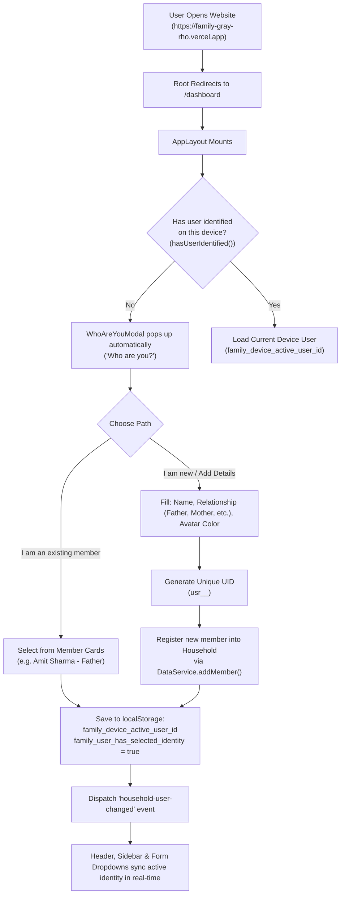

# 🏠 Family Expense & Budget Management System
> **Comprehensive Technical Architecture, Domain Model, and AI System Knowledge Base**
>
> *This document provides a complete, exhaustive, and machine-readable specification of the entire application. Any AI assistant, LLM agent, or software engineer reading this document will have complete understanding of the system architecture, domain models, business rules, routing, component hierarchy, responsive UI system, data flow, and deployment configuration.*

---

## 📌 1. Executive Summary & Purpose

- **Application Name**: Family Expense & Budget Management System
- **Domain**: Multi-member household personal finance, budget tracking, and shared ledger for Indian families.
- **Primary Currency**: Indian Rupee (`₹` INR) with standard Indian numbering system (`₹1,25,000` / `₹1.5L`).
- **Live Deployment URL**: `https://family-gray-rho.vercel.app`
- **Primary Entrypoint**: `https://family-gray-rho.vercel.app/dashboard` (the root `/` route automatically redirects to `/dashboard`).
- **Core Philosophy**: Zero-friction onboarding. Visitors can immediately start tracking expenses, setting budgets, and assigning expenditures to specific family members (Father, Mother, Son, etc.) without mandatory backend configuration, while supporting full Supabase cloud sync when credentials are provided.

---

## 🛠 2. Technology Stack & Runtime Specifications

| Layer | Technology | Details |
| :--- | :--- | :--- |
| **Framework** | **Next.js 15.5+** | App Router architecture, React Server Components (`RSC`) & Client Components (`"use client"`), standalone output tracing (`outputFileTracingRoot`). |
| **Runtime & Language** | **React 19 + TypeScript 5.8+** | Strict mode enabled, zero implicit `any`, complete interface coverage for all domain entities. |
| **Styling Engine** | **Tailwind CSS v4** | Modern `@tailwindcss/postcss` setup, custom semantic color tokens (CSS variables) for light & dark themes, fluid typography, responsive flex/grid primitives. |
| **Icons** | **Lucide React (`lucide-react`)** | Lightweight, consistent SVG icon set for financial categories, navigation, and user actions. |
| **Data Visualization** | **Recharts (`recharts`)** | ResponsiveContainer, AreaChart (spending trends), PieChart (category expenditure breakdown) with theme-aware tooltips and INR formatters. |
| **Form Management** | **React Hook Form + Zod** | Strongly-typed form schema validation for expenses, categories, budgets, and family members. |
| **Date & Time** | **date-fns** | Localized date handling, period boundaries (monthly, quarterly, yearly), recurring transaction date math. |
| **Data Persistence** | **Hybrid / Dual-Mode** | 1. **Supabase Cloud**: PostgreSQL database + Row Level Security (RLS) + Auth.<br>2. **Local Demo Engine**: Fully functional `localStorage` fallback with instant reactive state persistence. |
| **Deployment Platform**| **Vercel** | Configured via `vercel.json` with 100% pre-rendered static generation (`npm run build`). |

---

## 📁 3. Complete File & Directory Architecture

```
family/
├── public/                       # Static public assets, icons, manifest
├── src/
│   ├── app/                      # Next.js 15 App Router root
│   │   ├── (auth)/               # Auth route group (Authentication pages)
│   │   │   ├── login/page.tsx    # Supabase email/password login with demo mode toggle
│   │   │   ├── signup/page.tsx   # Household creation & registration
│   │   │   ├── forgot-password/  # Password reset request flow
│   │   │   └── reset-password/   # New password input flow
│   │   ├── (dashboard)/          # Authenticated / Demo dashboard route group
│   │   │   ├── dashboard/page.tsx# Main dashboard: metrics, charts, upcoming bills
│   │   │   ├── expenses/page.tsx # Ledger table, multi-filter search, CSV export, CRUD
│   │   │   ├── budgets/page.tsx  # Monthly budget tracking, utilization progress bars
│   │   │   ├── categories/page.tsx # Custom category management with color & icon picker
│   │   │   ├── recurring/page.tsx# Recurring bills, subscriptions & auto-scheduler
│   │   │   ├── reports/page.tsx  # Member breakdown, annual spending trends & exports
│   │   │   └── settings/page.tsx # Household info, member management, user switcher
│   │   ├── globals.css           # Tailwind v4 theme variables & global styles
│   │   ├── layout.tsx            # Root HTML layout with ThemeProvider & fonts
│   │   └── page.tsx              # Root index page -> Instant redirect to /dashboard
│   ├── components/
│   │   ├── dashboard/            # Specialized dashboard visual widgets (1:1 Figma system)
│   │   │   ├── lime-card-widget.tsx # Platina & Lime VISA Card with balance & masked number
│   │   │   ├── budget-line-chart.tsx # Smooth spline curve budget graph with noir tooltip bubble
│   │   │   ├── recent-transactions-widget.tsx # Merchant avatars (Supermarket, Swiggy, Netflix)
│   │   │   ├── spending-radar-chart.tsx # Hexagonal radar visualization across spend categories
│   │   │   ├── quick-transfer-widget.tsx # Family member transfer row with instant INR input & send
│   │   │   ├── promo-card.tsx    # "How to reduce expenses by 25%?" tips modal card
│   │   │   ├── category-pie-chart.tsx # Recharts doughnut chart for category breakdown
│   │   │   └── spending-trend-chart.tsx # Recharts 6-month area chart
│   │   ├── expenses/             # Expense modals & dialogs
│   │   │   ├── delete-dialog.tsx # Confirmation modal before deleting expenses
│   │   │   ├── expense-details-modal.tsx # Read-only full breakdown modal with receipt view
│   │   │   └── expense-dialog.tsx# Add / Edit expense modal with validation
│   │   ├── layout/               # Shell & responsive frame components
│   │   │   ├── app-layout.tsx    # Universal layout: Sidebar + Header + MobileNav + WhoAreYouModal
│   │   │   ├── header.tsx        # Top navigation bar, active user avatar, switch profile menu
│   │   │   ├── mobile-nav.tsx    # Fixed bottom bar for mobile screens with elevated "+" button
│   │   │   ├── sidebar.tsx       # Fixed desktop & tablet side navigation with household summary
│   │   │   └── who-are-you-modal.tsx # Automatic first-visit identity modal & user creator
│   │   └── ui/                   # Reusable atom-level UI design system components
│   │       ├── avatar.tsx        # Colored user initials avatar badge
│   │       ├── badge.tsx         # Pill badge for status (danger, warning, success, default)
│   │       ├── button.tsx        # Button with variants (default, outline, destructive, ghost)
│   │       ├── card.tsx          # Card container with CardHeader, CardTitle, CardContent
│   │       ├── category-icon.tsx # Dynamic Lucide icon resolver based on category name/icon
│   │       ├── empty-state.tsx   # Friendly empty state graphic and CTA button
│   │       ├── input.tsx         # Accessible text/number input with validation styling
│   │       ├── modal.tsx         # Backdrop dialog modal with ESC-key and click-outside close
│   │       ├── progress.tsx      # Multi-color progress bar with threshold indicators
│   │       ├── select.tsx        # Standard native select wrapper
│   │       ├── table.tsx         # Responsive table (Table, TableHeader, TableRow, TableCell)
│   │       ├── textarea.tsx      # Multi-line note/description input
│   │       └── theme-toggle.tsx  # Light / Dark / System theme switcher
│   ├── lib/
│   │   ├── calculations/
│   │   │   └── financials.ts     # Aggregation algorithms: monthly spend, budget utilization
│   │   ├── supabase/             # Supabase client integration
│   │   │   ├── client.ts         # Browser client createClient() with config check
│   │   │   ├── middleware.ts     # Edge auth token refresher & session guard
│   │   │   └── server.ts         # Server-side Supabase client for Server Actions/Routes
│   │   ├── validations/
│   │   │   └── index.ts          # Zod validation schemas (expenseFormSchema, etc.)
│   │   ├── data-service.ts       # Central data orchestrator (Dual-mode: Supabase / LocalStorage)
│   │   ├── demo-data.ts          # Default seed dataset for Sharma Residence household
│   │   ├── formatters.ts         # formatINR, formatCompactINR, formatDate, formatPercent
│   │   ├── types/
│   │   │   └── index.ts          # Central domain TypeScript interfaces & types
│   │   └── utils.ts              # clsx + twMerge utility function `cn(...)`
│   └── middleware.ts             # Next.js root request middleware
├── next.config.ts                # Next.js configuration with outputFileTracingRoot
├── package.json                  # Dependencies, scripts, and package metadata
├── tsconfig.json                 # TypeScript compiler options
├── vercel.json                   # Vercel deployment framework settings
└── AI_SYSTEM_OVERVIEW.md         # This master knowledge base file
```

---

## 👥 4. Identity Architecture & "Who Are You?" Onboarding Engine

One of the standout requirements of this application is its frictionless multi-user identity flow on a shared family device (desktop, iPad, or mobile phone):



### Key Identity Rules:
1. **Unique User ID (`user_id`)**:
   - Every family member is assigned a unique, immutable string identifier formatted as:
     `usr_${Date.now()}_${Math.random().toString(36).substring(2, 9)}` (e.g. `usr_1773489123000_k9x2m4`).
2. **Relationship Attribute**:
   - Every member has a defined family relation stored in `member.relationship` (e.g., `"Father"`, `"Mother"`, `"Son"`, `"Daughter"`, `"Grandfather"`, `"Grandmother"`, `"Partner / Spouse"`, `"Brother"`, `"Sister"`).
   - Display format across the app: `Amit Sharma (Father)` or `Priya Sharma (Mother)`.
3. **Local Storage Keys**:
   - `family_user_has_selected_identity`: Boolean `"true"` once a visitor selects or creates their identity.
   - `family_device_active_user_id`: Stores the current active `user_id` for that browser/device.
   - `family_demo_state_v1`: Contains the complete persisted JSON store of households, members, expenses, budgets, categories, and recurring bills.
4. **Switching Identities Anytime**:
   - Any user can switch identity at any time by clicking their avatar in the **Header**, the identity card in the **Sidebar**, or the **Switch User** button in **Settings**.
   - This triggers the global custom DOM event `window.dispatchEvent(new Event("open-who-are-you"))`.

---

## 📊 5. Core Domain Entities & TypeScript Models

### 1. `HouseholdMember`
Represents an individual person in the family unit:
```typescript
export interface HouseholdMember {
  id: string;               // e.g. "mem-1"
  household_id: string;     // Foreign key to Household
  user_id: string;          // Unique UID: "usr-amit" or "usr_1773489123000_k9x2m4"
  display_name: string;     // e.g. "Amit Sharma"
  relationship?: string;    // e.g. "Father", "Mother", "Son", "Daughter"
  email: string;            // e.g. "amit@family.local"
  role: "admin" | "member"; // Admin can manage household settings; member can log expenses
  color: string;            // Hex color code for avatar and charts, e.g. "#2563eb"
  joined_at: string;        // ISO 8601 string
}
```

### 2. `Expense`
The central transaction record:
```typescript
export interface Expense {
  id: string;               // e.g. "exp-101"
  household_id: string;     // Foreign key to Household
  category_id: string;      // Foreign key to Category (e.g. "cat-groceries")
  amount: number;           // Transaction value in INR (e.g. 4680)
  description: string;      // e.g. "Weekly Grocery Run (DMart)"
  expense_date: string;     // "YYYY-MM-DD" e.g. "2026-10-13"
  paid_by_user_id: string;  // user_id of the member who paid
  created_by_user_id: string;// user_id of who entered the record
  payment_method: PaymentMethod; // "UPI" | "Cash" | "Credit Card" | "Debit Card" | "Net Banking"
  receipt_path?: string;    // Optional image or document receipt path/filename
  notes?: string;           // Optional extra context or notes
  created_at: string;       // ISO timestamp
  updated_at: string;       // ISO timestamp
}
```

### 3. `Budget`
Monthly limit allocated to the household overall or a specific category:
```typescript
export interface Budget {
  id: string;               // e.g. "b-overall"
  household_id: string;
  category_id: string | null;// null represents Overall Household Budget; string represents Category Budget
  amount: number;           // Target monthly expenditure ceiling in INR (e.g. 90000)
  period: "monthly" | "yearly";
  period_start: string;     // e.g. "2026-10-01"
}
```

### 4. `Category`
Spending classification:
```typescript
export interface Category {
  id: string;               // e.g. "cat-groceries"
  household_id: string;
  name: string;             // e.g. "Groceries & Supermarket"
  icon: string;             // Lucide icon name, e.g. "ShoppingCart", "Utensils", "Car"
  color: string;            // Hex color, e.g. "#16a34a"
  is_active: boolean;       // Soft-deletion flag
  is_system: boolean;       // System default categories cannot be deleted
}
```

### 5. `RecurringExpense`
Scheduled subscriptions, bills, or rent:
```typescript
export interface RecurringExpense {
  id: string;
  household_id: string;
  category_id: string;
  amount: number;
  description: string;      // e.g. "Airtel Xstream Fiber Broadband"
  frequency: "daily" | "weekly" | "monthly" | "quarterly" | "yearly";
  start_date: string;
  next_occurrence: string;  // ISO date string: "2026-10-20"
  paid_by_user_id: string;
  created_by_user_id: string;
  payment_method: PaymentMethod;
  is_active: boolean;
}
```

---

## 🗺 6. Routing & Page Specifications

All primary application views are rendered under the `(dashboard)` group, sharing the universal responsive layout `AppLayout`:

| Route | Page File | Function & User Capabilities |
| :--- | :--- | :--- |
| `/` | `src/app/page.tsx` | **Root Redirect**: Immediately redirects browser to `/dashboard` with 307 temporary redirect. |
| `/dashboard` | `src/app/(dashboard)/dashboard/page.tsx` | **Overview Dashboard**: Displays 4 metric KPI cards (Spent This Month, Annual Total, Budget Remaining, Utilization %), 6-month historical spending trend area chart, top expense categories doughnut chart, recent 5 expenses with instant inspection, upcoming recurring bills. |
| `/expenses` | `src/app/(dashboard)/expenses/page.tsx` | **Ledger & Expense Manager**: Search filter, category filter, member filter, payment method filter, date range picker, column sorting, pagination (15/page), CSV download, Add Expense modal, Edit Expense modal, Delete confirmation dialog, and full expense details preview. |
| `/budgets` | `src/app/(dashboard)/budgets/page.tsx` | **Budget Planner**: Monthly budget status bars with color thresholds (Green: <80%, Amber: 80-100%, Red: >100%), overall household budget, per-category breakdown, edit budget dialog. |
| `/categories` | `src/app/(dashboard)/categories/page.tsx` | **Category Center**: Card grid of active spending categories, transaction counts, total expenditures, custom category creator with Lucide icon and color picker. |
| `/recurring` | `src/app/(dashboard)/recurring/page.tsx` | **Recurring Bills & Subscriptions**: Tracks fixed bills (Rent, Broadband, Netflix, Dairy), shows countdowns to next due dates, toggle active/pause, "Record Now" button to automatically create an expense transaction. |
| `/reports` | `src/app/(dashboard)/reports/page.tsx` | **Financial Analytics**: Deep-dive spending analytics by family member (who spends the most), monthly comparison tables, percentage shares, category heatmaps, printable view. |
| `/settings` | `src/app/(dashboard)/settings/page.tsx` | **Household & Member Settings**: Household display name, default currency, family member list with unique User IDs, add new member form, switch active user on this device, cloud database status. |
| `/login` | `src/app/(auth)/login/page.tsx` | **Supabase Authentication**: Email/password authentication, demo mode bypass button. |
| `/signup` | `src/app/(auth)/signup/page.tsx` | **New Family Registration**: Creates new Supabase household and initial admin user. |

---

## 📱 7. Responsive Layout & Device Compatibility System

The UI adapts gracefully across **Mobile (< 640px)**, **Tablet (640px - 1024px)**, and **Desktop (> 1024px)**:

```
+-----------------------------------------------------------------------------------+
| Desktop & Tablet Layout (>= 768px):                                               |
| +----------------------+--------------------------------------------------------+ |
| | [Sidebar]            | [Header] Title | Subtitle | Active Member | Quick Add  | |
| | - Logo & Household   +--------------------------------------------------------+ |
| | - Nav Links          | [Main Content Area]                                    | |
| | - Active User Pill   | - Responsive Grids (1 col mobile, 2 tablet, 4 desktop)  | |
| | - Member Count       | - Horizontally Scrollable Tables (overflow-x-auto)     | |
| |                      | - Responsive Recharts Visualizations                   | |
| +----------------------+--------------------------------------------------------+ |
+-----------------------------------------------------------------------------------+

+-----------------------------------------------------------------------------------+
| Mobile Layout (< 768px):                                                          |
| +-------------------------------------------------------------------------------+ |
| | [Header] Logo | Title | Active Member Avatar & Switcher | Theme Toggle        | |
| +-------------------------------------------------------------------------------+ |
| | [Main Content Area] (Full width with safe horizontal padding)                 | |
| |                                                                               | |
| +-------------------------------------------------------------------------------+ |
| | [MobileNav - Fixed Sticky Bottom Bar]                                         | |
| |  [Home]       [Expenses]       ( + Quick Add )       [Budgets]     [Settings] | |
| +-------------------------------------------------------------------------------+ |
+-----------------------------------------------------------------------------------+
```

### Specific Responsive Implementations:
1. **Sidebar (`src/components/layout/sidebar.tsx`)**:
   - `hidden md:flex flex-col w-64 border-r border-border shrink-0 min-h-screen`: Completely hidden on mobile to maximize viewport area; visible and fixed on tablet/desktop.
2. **Bottom Navigation Bar (`src/components/layout/mobile-nav.tsx`)**:
   - `md:hidden fixed bottom-0 left-0 right-0 z-40 h-16 border-t border-border bg-card/95 backdrop-blur-md`: Displays exclusively on mobile devices.
   - Includes an elevated center **"+" Quick Add Button** (`-mt-5 flex h-12 w-12 rounded-full bg-primary`) allowing family members to log an expense in one tap on their smartphone.
3. **Data Tables (`src/components/ui/table.tsx`)**:
   - Every table container is wrapped in `overflow-x-auto w-full` with `-webkit-overflow-scrolling: touch`, ensuring tables never break mobile layout boundaries.
4. **Modal Dialogs (`src/components/ui/modal.tsx`)**:
   - Designed with `max-w-md sm:max-w-lg lg:max-w-2xl max-h-[90vh] overflow-y-auto w-full mx-4` so dialogs always fit within small mobile screens without getting cut off.

---

## 💾 8. Data Architecture & Reactive Service Layer

All data access is mediated through the singleton `DataService` in `src/lib/data-service.ts`.

### 1. Dual-Mode Operation:
- **Cloud Mode (`isSupabaseConfigured() === true`)**:
  Connects to Supabase tables (`households`, `household_members`, `categories`, `expenses`, `budgets`, `recurring_expenses`, `activity_logs`) using the Supabase client.
- **Local/Demo Mode (`isSupabaseConfigured() === false`)**:
  When environment variables `NEXT_PUBLIC_SUPABASE_URL` and `NEXT_PUBLIC_SUPABASE_ANON_KEY` are unset, `DataService` transparently reads and writes to `localStorage` under `family_demo_state_v1`, pre-populated with the comprehensive demo dataset (`DEMO_HOUSEHOLD`, `DEMO_MEMBERS`, `DEMO_EXPENSES`, `DEMO_BUDGETS`, etc.).

### 2. Event-Driven Cross-Component Synchronization:
To prevent stale state between independent components without requiring heavy Redux/Zustand dependencies, `DataService` uses custom browser events:
- **`household-user-changed`**: Dispatched when active user switches or a new member is added. Triggers Header, Sidebar, and Form dropdown re-renders.
- **`household-expense-updated`**: Dispatched when an expense is created, edited, or deleted. Triggers Dashboard and Ledger re-fetches.
- **`open-who-are-you`**: Dispatched by any "Switch Profile" button to bring up the identity selection modal.

---

## 🇮🇳 9. Financial Localization & Formatters

All monetary values adhere strictly to Indian standards:
- **`formatINR(amount: number): string`**:
  Uses `Intl.NumberFormat("en-IN", { style: "currency", currency: "INR", maximumFractionDigits: 0 })`.
  - Input: `4680` -> Output: `₹4,680`
  - Input: `125000` -> Output: `₹1,25,000`
- **`formatCompactINR(amount: number): string`**:
  Compact representation for mobile KPI cards and charts:
  - Input: `95000` -> Output: `₹95K`
  - Input: `125000` -> Output: `₹1.25L`
  - Input: `10000000` -> Output: `₹1Cr`
- **`formatDate(dateString: string): string`**:
  Formats dates cleanly as `13 Oct 2026`.

---

## 🚀 10. Build, Lint & Vercel Deployment Verification

### 1. Configuration Files:
- **`next.config.ts`**:
  ```typescript
  import type { NextConfig } from "next";
  import path from "path";

  const nextConfig: NextConfig = {
    outputFileTracingRoot: path.resolve(__dirname),
  };

  export default nextConfig;
  ```
  *(Prevents monorepo/parent lockfile conflicts during Vercel builds).*

- **`vercel.json`**:
  ```json
  {
    "framework": "nextjs",
    "buildCommand": "npm run build"
  }
  ```

### 2. Verification Commands & Health Status:
- **Type Check**: `npx tsc --noEmit` -> **0 errors**.
- **Linter**: `npm run lint` -> **0 errors, 0 warnings**.
- **Production Build**: `npm run build` -> **Exit code 0, 16/16 static pages generated**.

---

## 🤖 11. Instructions for Future AI Agents & Developers

When inspecting, modifying, or extending this repository, adhere strictly to these rules:

1. **Preserve Dual-Mode Compatibility**:
   - Any new feature or entity added must work in **both** Supabase mode and LocalStorage demo mode inside `src/lib/data-service.ts`.
2. **Preserve Indian Rupee Formatting**:
   - Always format monetary displays using `formatINR` or `formatCompactINR` from `src/lib/formatters.ts`. Never hardcode `$` or generic currency symbols.
3. **Preserve "Who Are You?" Multi-User Mechanics**:
   - Expenses must always be linked to a valid `paid_by_user_id`. When rendering author or payer selects, always show `member.display_name` alongside their family role `(member.relationship || member.role)`.
4. **Preserve Responsive Primitives**:
   - Do not remove `MobileNav` or modify `AppLayout` in a way that disrupts mobile viewport handling (`pb-24 md:pb-8`).
   - Keep table wrappers with `overflow-x-auto`.
5. **No Regressions on Build**:
   - Always run `npx tsc --noEmit` and `npm run build` before considering any task complete.
